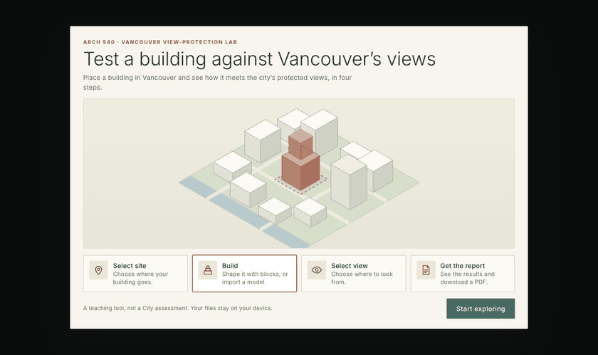
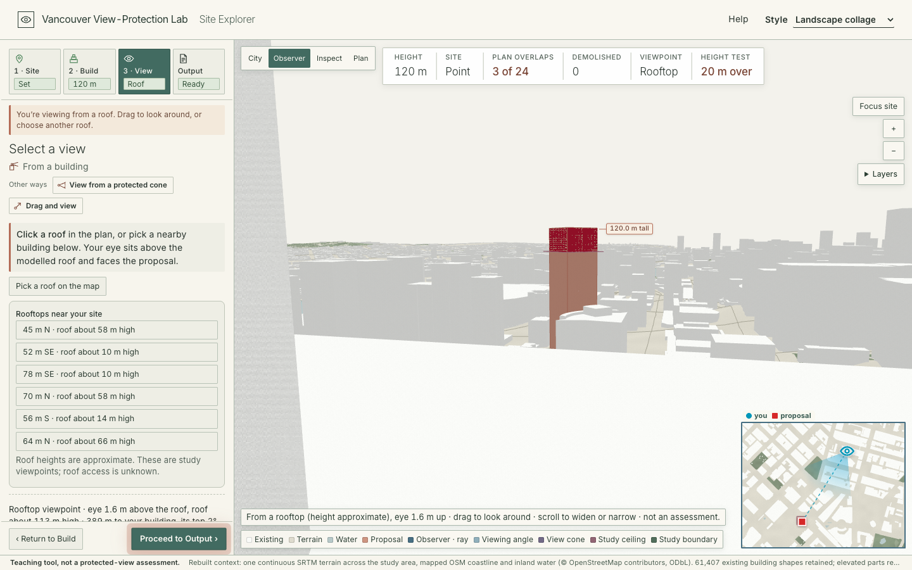

# Vista — Vancouver View Protection Tool

**[Open the tool in your browser](https://ruijieliu6.github.io/vancouver-tall-view-tool/)** · [Report an issue or a review](https://github.com/RuijieLiu6/vancouver-tall-view-tool/issues/new) · ARCH 540, Assignment 1 · release v37 (November 3, 2026)

[Watch the recorded demo (2:04)](https://drive.google.com/file/d/1DWnL5P9Co1HlqFtK4MfyUDTMS3ZeET8c/view) · [Replay the opening animation](https://ruijieliu6.github.io/vancouver-tall-view-tool/?intro=1)

The captioned demo follows address search, site placement, tower height and rotation, rooftop viewing, protected viewpoints, and PDF export. A visible pointer and click highlights make the interactions easier to follow. The recording starts with a skyline view; the separate opening-animation link always replays the introduction, including on a return visit.

## 1. Purpose

Vancouver's protected public views shape where and how towers can be built, but the corridors are difficult to read against a design proposal. I made Vista for architecture students and early-stage designers who want to explore a massing idea before a formal assessment. Choose a downtown site, build or import a proposal, and see which of the City's mapped view corridors its footprint overlaps. Then inspect approximate views from a corridor's polygon-derived origin, a nearby roof, or a point on the ground, and export a visual report. The City's open-data polygons contain plan boundaries but no cone height limits. The tool reveals spatial relationships and design questions; it does not decide whether a building meets the Public Views Guidelines.

## 2. How to use it

The tool is a web page; it needs no installation. Open the link above in a desktop browser with WebGL2 (recent Chrome, Edge, Firefox or Safari). The first visit shows a short introduction; **Help** in the top bar opens it again. New here? **Or start from a real tower** on the introduction loads a complete study of Shangri-La Vancouver, Vancouver House or The Butterfly in one click.

The tool works in four steps. In each step you choose one method; the panel then offers the other methods as buttons if you want to switch, **Proceed** moves on and **Return** goes back.

1. **Site.** *Open spot on the plan*: optionally find an area with a neighbourhood or a downtown address (live suggestions support incomplete addresses and typos; **Place site here** puts the site at the address), then click open ground or draw a boundary. *Replace a building* or *Replace several buildings*: click buildings in the plan, then use them as the site.
2. **Build.** *Build on the platform*: stack and size blocks (height, width, depth, rotation, offsets), with tower dimensions in metres, feet or millimetres (m/ft/mm). *Upload model*: a Rhino `.3dm` or `.obj` file, processed on your device with progress and cancellation. Source cadastral parcels beneath the placed proposal are matched and joined automatically where the source geometry supports a safe union; ambiguous joins remain separate for review. Existing buildings under the proposal are shown as demolished; a checkbox keeps them.
3. **View.** *View from a protected cone*: select a viewpoint, then click **View from here** to stand at an approximate origin derived from the mapped polygon. *View from a building*: stand on a modelled roof. *From the street*: click a mapped street for an approximate eye-level view facing your proposal. **Previous** and **Next** cycle nearby streets, roofs or protected viewpoints. *Drag and view*: press a spot in the plan, drag toward what you want to see and release. Before entering a viewpoint, **Free inspection** lets you orbit the model. The corner map stays visible, previews the selected origin, and shows your position and viewing direction after you enter. In Observer view, arrow keys walk forward/back or sidestep; hold Shift for faster steps. Drag or use I/J/K/L to look around. Movement follows approximate ground or the selected roof and checks modelled obstacles.
4. **Output.** A one-sentence summary, then the mapped view corridors that overlap the proposal in plan; optionally test a study ceiling (your own assumption, not a City limit), then choose the **PDF contents** and **Export PDF**. Every protected view whose corridor overlaps the proposal gets a page with existing and proposed views from its polygon-derived origin, a key plan and a section. **Start a new study** clears everything.

**Height suggestion** appears when entering Build. Adjust scales the platform blocks together below the available study surfaces with 0.1 m clearance over the complete rotated footprints; Dismiss keeps your dimensions, and Undo restores the previous blocks. **Adjust height below cone** applies the selected blue surface. Missing corridor surfaces remain disclosed. This is a study-height suggestion, not a City height entitlement.

**Storage.** New application data uses temporary page memory or project files. Imagine reads precomputed project data; Vista creates no new browser application databases or saved localStorage settings. Old Vista caches are removed by exact names. Older parcel edits and custom assumptions require a confirmed local project-file backup before their browser copy is removed; on the read-only public site, legacy studies are retained until that backup is possible. New Imagine edits are page-only: export CSV to keep them. Packaged public height records can be reused; new public-site calculations stay in memory. Browser-managed asset caching and active rendering memory are separate.

**Imagine Vancouver** reuses the same Vancouver model and viewport. Its left panel compares **Existing**, **Height references** and **With view cones**, with all 24 mapped corridors overlaid as transparent blue study surfaces. Plain, Night and Context remain available. Prepared intersections link 61,407 source building objects to whole-footprint zoning references and view corridors. The lowest available surface controls height over each footprint, with 0.1 m clearance; connected towers and podiums scale together. Click a building for its controlling corridor, ceiling, clearance and sources. **Return to my study** restores the normal model and proposal; CSV export keeps the comparison. Data loads once and up to six calculated scenarios are reused in temporary memory.

Generated surfaces remain **Study / unverified**. The adjustable default connects approximate modelled observer eyes to a fixed downtown reference at model (0, 0); it is not official City ceiling geometry or a sea-level elevation. Basic zoning references have stated use and grade conditions; unresolved heights can use an explicitly labelled scenario fallback. The left panel explains zoning/density, setbacks, tower massing, solar access and building-code feasibility. Those other constraints are not all calculated, and these height-only changes on source building footprints are not complete legal parcel envelopes or development rights.

**Geographic location** reads and locates positions using the existing model anchor. It accepts WGS84 longitude/latitude, Web Mercator and approximate NAD83 / UTM zone 10N. **Show on model** moves the view first; **Use as study site** asks for placement confirmation. GeoJSON boundary/location imports and exports preserve coordinate provenance. Approximate horizontal alignment is not a survey transformation, and no vertical datum conversion is applied.

**Sources** explains public alternatives for reconstructing height information: published development-application height sheets, policy reference geometry, released technical records, LiDAR/terrain, cadastral boundaries and independent cross-checks. Direct source links, a worked historical reconstruction and explicit limitations distinguish retrieved measurements from assumptions and verified current limits. No private survey or editable Rhino file is included.

**View-cone envelope** in Output accepts a full parcel boundary and supplied lower-plane geometry. It clips all applicable surfaces across the footprint, including holes, islands and overlapping corridors, and reports the lowest controlling surface. **Check proposal geometry** compares actual proposal triangles and reports control coordinates, clearance and sources. OBJ and calculation JSON exports retain the resulting upper constraint surface. A complete sourced reconstruction may be Preliminary; self-declared assessment records do not unlock Verified. Missing surfaces or coordinate/datum evidence remain unresolved.

The strip above the map summarizes the study as you work; **?** at its end explains each number. **Style** in the top bar switches between Plain, Night and Context. Context adds continuous ground road surfaces, nearby sidewalks and lane markings, plus illustrative bridge decks; these road surfaces appear only in Context. Widths, sidewalks and bridge levels are approximate. **Layers** controls labels, road surfaces and an experimental 2022 aerial photo texture. The map also works from the keyboard: arrow keys move the view, + and − zoom, and Enter acts at the centre of the view.

## 3. Source

- City of Vancouver, [*Public Views Guidelines*](https://guidelines.vancouver.ca/guidelines-public-views.pdf), approved by Council July 10, 2024, last amended February 4, 2026.
  - Section 2, Application and Intent (p.3): a protected view is an origin point, view cones with two vertical boundaries, and a horizontal lower boundary (the maximum height).
  - Section 3.1, Table 1 (pp.4–6): the protected public views, their origin points and subjects.
  - Section 3.2, Building Height and Massing, clause printed 3.1.1 (p.6): no part of a building should encroach into the relevant view cones. Clauses 3.1.2 to 3.1.5 (pp.6–7) are shown as text for people to judge.
- City of Vancouver open data, [view-cones](https://opendata.vancouver.ca/explore/dataset/view-cones/) (plan polygons only; the cone heights are not in this dataset).

The tool computes plan relations, exploratory views and constraints from the inputs supplied to a study. The public corridor dataset alone does not define the City's ceiling surfaces. The tool does not establish current permitted heights, view-shadow compliance (3.3) or Exceptional Downtown Sites (3.4).

## 4. One example

**Input.** Start from the real tower **Shangri-La Vancouver** (1128 W Georgia St, 201 m, 62 storeys, 2008): the four modelled parts of the tower are replaced (*Replace several buildings*) and one block of the published height stands on their footprint (29 × 43 m, approximate). View from the roof of a modelled building about 253 m south of the site (roof about 23 m high), eye 1.6 m above the roof.

**Result.** One mapped view corridor overlaps the block in plan: **3.2.1 Queen Elizabeth Park**. Turn on the height experiment with a 180 m study ceiling and it reads **21.0 m above your study ceiling**, your own assumption, not a City limit. To reproduce it, choose **Shangri-La** under *Or start from a real tower* on the intro (or in step 1), or open [`media/example-study.json`](media/example-study.json) with **Study file › Open study**. The other two presets are **Vancouver House** (1480 Howe St, 152 m to roof, 52 storeys, 2020, BIG with DIALOG; no corridor overlaps it in plan) and **The Butterfly** (969 Burrard St, 170 m to roof, 57 storeys, 2024, Revery Architecture; one overlap, 3.2.1). Heights are the published roof heights; footprints are approximate.

## 5. Skill and limits

- Building heights come from OpenStreetMap and the supplied model and are unverified; the model's vertical datum is unknown. Terrain is approximate (60 m SRTM).
- View-cone ceiling surfaces are not established by the loaded public corridor data. A supplied or reconstructed surface can be evaluated mathematically, but plan overlap and study results are not a City assessment. Current citywide official maxima remain unknown.
- Study boundaries and replaced-building outlines are approximate model outlines, not legal parcels.
- Viewpoint origins are estimated from polygon geometry, not verified survey coordinates; rendered views are exploratory. Routine per-part checks use bounding approximations. The separate on-request envelope geometry check clips actual triangles within its stated analysis budgets. Neither establishes a legal development entitlement.
- The address box sends what you type to the City of Vancouver open-data portal (once, to load downtown addresses) and to the BC Address Geocoder for suggestions. The aerial texture loads City orthophoto tiles. Studies and PDF reports are made on your device and are not uploaded.
- A person must check any result against the City's by-laws and the Public Views Guidelines.

## Sources and attribution

- View cones and 2022 orthophotos: City of Vancouver Open Data, [Open Government Licence – Vancouver](https://opendata.vancouver.ca/pages/licence/). City civic addresses: [property-addresses](https://opendata.vancouver.ca/explore/dataset/property-addresses/), same licence.
- Address geocoding: © Province of British Columbia, [BC Address Geocoder](https://digital.gov.bc.ca/bcgov-common-components/bc-address-geocoder/), [Open Government Licence – British Columbia](https://www2.gov.bc.ca/gov/content/data/open-data/open-government-licence-bc).
- Streets, water, parks and simplified buildings outside the supplied model: © [OpenStreetMap contributors](https://www.openstreetmap.org/copyright), [ODbL](https://opendatacommons.org/licenses/odbl/). Terrain and mountains: NASA SRTM via [Open Topo Data](https://www.opentopodata.org/).
- The central Vancouver context is a derived browser export of a supplied studio Rhino model; the original `.3dm` file is not included. Interface type: [Inter](https://rsms.me/inter/) (SIL Open Font Licence).

The browser scene data in this release is public and downloadable. Original editable Rhino models are not included in the public release.

This bundle is generated with `tools/build_pages.py` from a private working project; `release-manifest.json` lists every file with its size and SHA-256 hash.
